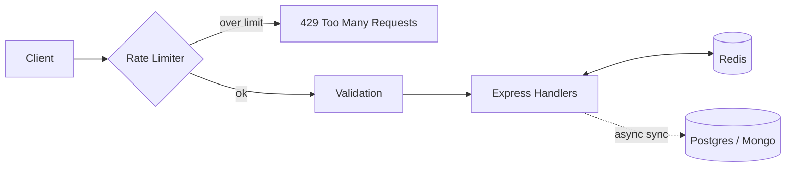
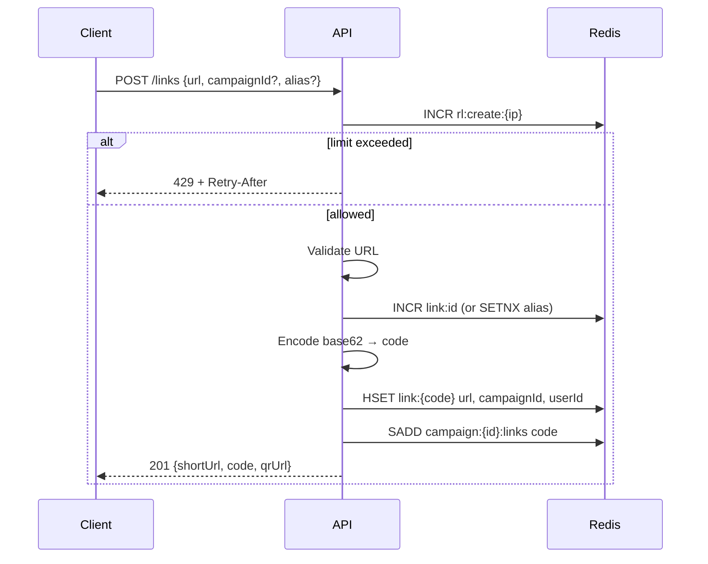
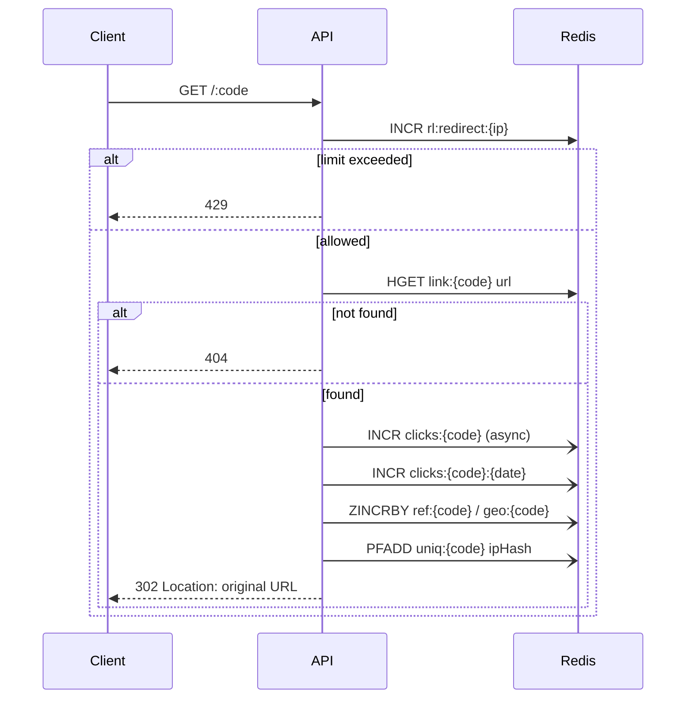
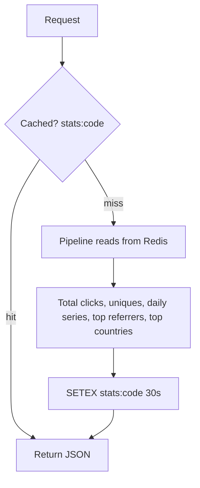
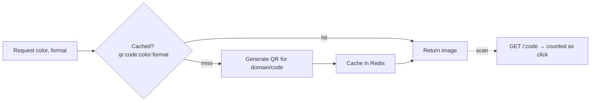

# LinkPulse

URL shortener with redirect rules, click analytics, and admin controls. Built for the Tech Geeks hackathon.

## Core Idea

The `Link` is the central record. Campaigns organize links, while rules (expiry, click limit, password, and status) control redirects. Click events power the analytics dashboard. Disabled or expired links retain their analytics.

## Stack

- **Backend:** Node.js, Express, MongoDB, Redis
- **Frontend:** TODO

## Project Structure

```text
linkpulse/
├── backend/    # Backend development
├── frontend/   # Frontend development
└── README.md
```

## Branch Strategy

- `main`: Stable, integrated code.
- `backend-dev`: Backend developer.
- `frontend-yourname`: Individual frontend branches.

Each developer must work on their own branch.

## Getting Started

```bash
git clone https://github.com/USERNAME/REPO.git
cd REPO
```

Replace `USERNAME/REPO` with the actual GitHub repository path.

## Developer Instructions

### Backend Developer

Create your branch once:

```bash
git switch -c backend-dev
git push -u origin backend-dev
```

Before starting work:

```bash
git switch backend-dev
git pull origin backend-dev
```

After making changes:

```bash
git add backend/
git commit -m "feat: describe backend changes"
git push
```

### Frontend Developers (All 3 Members)

Each frontend developer must create a **separate branch**.

Create your branch once:

```bash
git switch main
git pull origin main
git switch -c frontend-yourname
git push -u origin frontend-yourname
```

Replace `frontend-yourname` with your own branch name.

Before starting work:

```bash
git switch frontend-yourname
git pull origin frontend-yourname
```

After making changes:

```bash
git add frontend/
git commit -m "feat: describe frontend changes"
git push
```

Each member should commit only their relevant changes.

## Sync Your Branch with Main

To bring the latest integrated changes into your branch:

```bash
git fetch origin
git merge origin/main
```

## To merge your branch into main

```bash
git switch main
git pull origin main
git merge backend-dev
git push origin main
```

Resolve any merge conflicts before continuing.

## Pull Request Workflow

1. Push your feature branch to GitHub.
2. Open a Pull Request from your branch into `main`.
3. Request a review from a teammate.
4. Resolve conflicts and address feedback.
5. Merge after approval.

Never merge unreviewed changes directly into `main`.

## Team Rules

- Never push directly to `main`.
- Never commit `.env` files, credentials, or secrets.
- Coordinate changes to shared files such as `README.md` and `package.json`.
- Pull the latest changes before starting work.
- Use meaningful commit messages.
- Communicate API changes between frontend and backend developers.
- Keep frontend and backend code inside their respective folders.

## Backend Work Flow
## API Flow

### Architecture



### Create Short Link: `POST /links`



### Redirect + Analytics: `GET /:code`



### Stats: `GET /links/:code/stats`



### QR Code: `GET /links/:code/qr`



## Setup Instructions

Backend and frontend installation and environment setup instructions will be added once the project scaffolds are ready.
